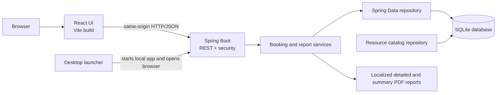
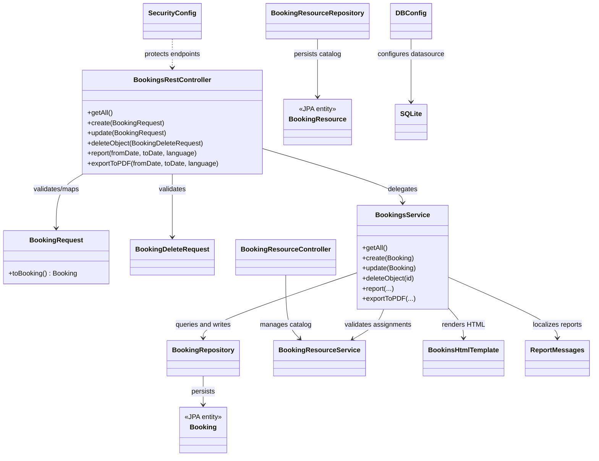

# Architecture

## System overview

In production, the frontend build is packaged as static resources in the
Spring Boot application. The desktop launcher is an optional wrapper around
that application; Docker and direct Maven runs start the same backend without
the desktop wrapper. SQLite is the application database, with its location
selected by the runtime configuration.

LAN clients connect to the host running the application; the SQLite file
remains on that host. Desktop and Docker host access are loopback-only by
default. Enabling LAN access is a deployment setting and does not create
additional user accounts or permissions.

## Request and persistence flow

1. The React screen loads data through the frontend API module and uses `/api/v1/users/me` for role-aware UI gating.
2. Spring Security authenticates the session against database-backed users, enforces role-based authorization, and applies CSRF protection to browser writes.
3. REST controllers validate request DTOs and delegate to services.
4. Services apply booking/user rules and call repositories.
5. Spring Data JPA persists entities in SQLite.
6. Report requests use the same service/data path and return report text or a PDF response.

The database backup/restore CLI is an offline path. `Application` dispatches
the `db` command to `DatabaseCli` before starting Spring Boot.

## Main backend class relationships

The diagram is intentionally a small domain view rather than a complete
dependency graph. The request DTOs are API-boundary types; `Booking` is the
persistence entity and domain data type.

## Architectural decisions

### Keep HTTP/JSON and SQLite for now

The browser and backend are part of one application, requests are synchronous,
and the application currently uses a single SQLite database. REST with JSON
is a direct fit for these boundaries and is straightforward to inspect, test,
and version. API routes use `/api/v1`; existing unversioned paths remain
compatibility aliases.

### Protocol Buffers

Do not add Protocol Buffer models at this stage. Protobuf is useful when there
is a concrete requirement for compact binary payloads, generated clients
across multiple independently deployed services, or a gRPC contract. It would
otherwise introduce a schema, code-generation step, and a second representation
of the same booking data without solving a current problem.

Keep the HTTP API's request/response types explicit (for example
`BookingRequest`) and validate them at the API boundary. If future clients
need stronger shared contracts, first consider publishing an OpenAPI
specification and generating or validating HTTP clients from it.

### Kafka

Kafka would be overkill for the current deployment. There is no independent
consumer, event-streaming requirement, or workload requiring asynchronous
decoupling. Adding a broker would increase installation, operations, data
consistency, and failure-handling complexity—especially for a local desktop
application backed by SQLite.

Revisit a message broker only when there is a specific need such as durable
integration events consumed by multiple independent services, asynchronous
work that must survive process restarts, or sustained throughput that the
current synchronous design cannot handle. A broker is not a replacement for
the application's SQLite persistence.

## Current boundaries and growth

- **Authentication and permissions:** database-backed users with roles `ADMIN`, `OPERATOR`, and `GUEST` (legacy `USER` accepted/migrated to `OPERATOR`). Admins manage users/resources/admin ops and can view reports; operators manage bookings and view reports; guests have read-only booking visibility. The system prevents removing/deactivating/deleting the last active admin or operator.
- **Resources:** rooms and vehicles are persisted as managed resources; the existing booking `room` column stores their stable resource IDs.
- **Database:** SQLite with JPA `ddl-auto=update` and `DatabaseInitializer` bootstrap/migration logic. Adopt versioned migrations before schema-altering changes.
- **Deployment:** the backend and compiled frontend are one application artifact. Desktop packaging, Docker, and direct Maven execution are alternative launch/deployment paths.
- **API compatibility:** breaking external API changes should use a new major version prefix instead of changing `/api/v1` behavior.
